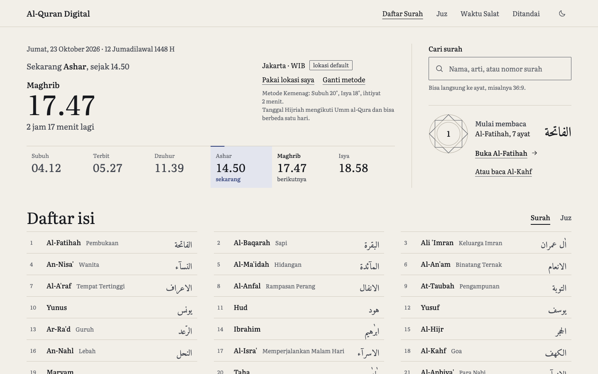
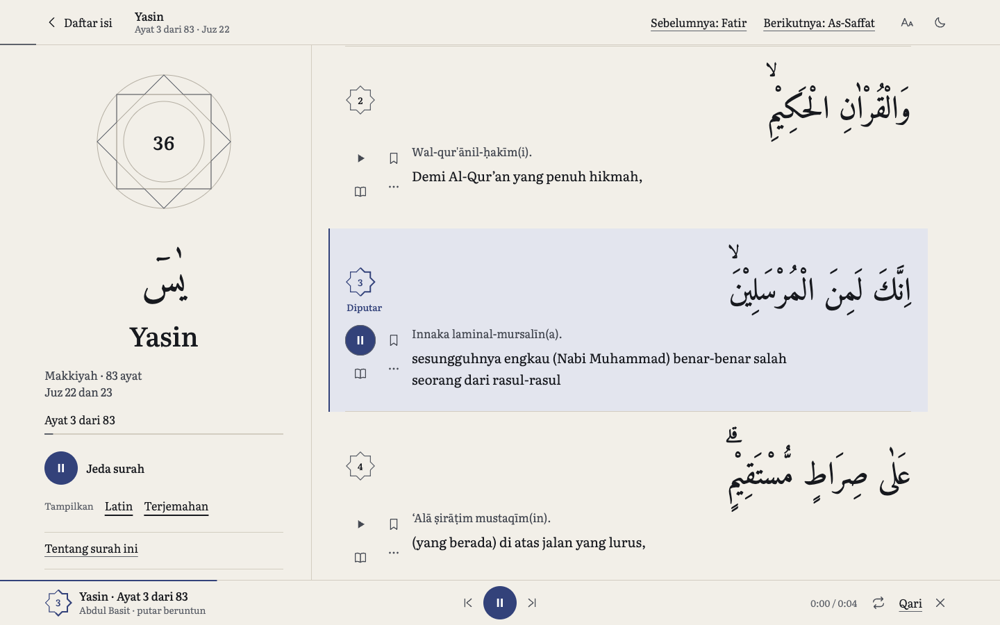
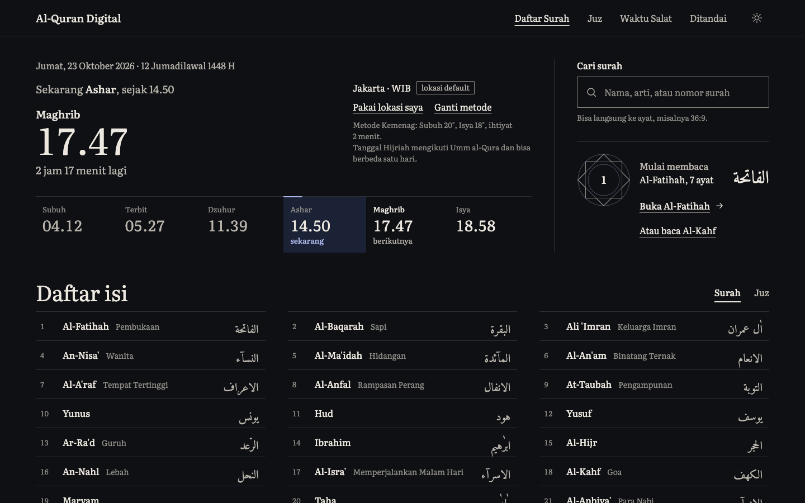
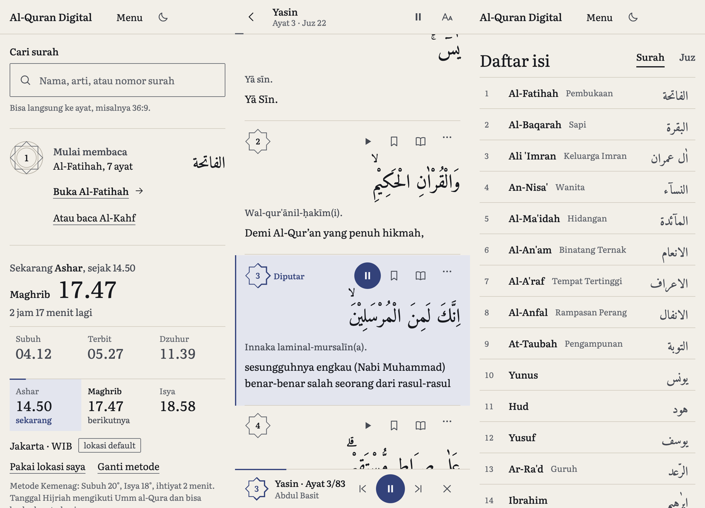

# Al-Quran Digital

Aplikasi web untuk membaca Al-Quran dengan terjemahan Bahasa Indonesia, mendengarkan murattal per ayat, dan melihat jadwal salat sesuai lokasi. Tampilannya dibangun di atas geometri Islam: setiap surah punya bingkai bintang delapan yang tergambar saat halamannya dibuka, teks Arab memakai Amiri Quran, dan teks Latin memakai Literata.

Demo: [qurandigital-kappa.vercel.app](https://qurandigital-kappa.vercel.app/)









## Fitur

### Membaca

- 114 surah dengan teks Arab, transliterasi, dan terjemahan Kemenag dari equran.id.
- Basmalah tampil sebagai kepala surah tanpa nomor. Al-Fatihah memuatnya sebagai ayat 1, dan At-Taubah dibuka tanpa Basmalah.
- Tafsir Kemenag per ayat, keterangan tiap surah, serta penanda awal juz dan hizb.
- Tautan langsung ke ayat, misalnya `/surah/2/255`. Posisi baca terakhir tersimpan dan bisa dilanjutkan dari beranda.
- Ayat bisa ditandai, lalu dikumpulkan di halaman Ditandai.
- Pencarian menerima nama, arti, atau nomor surah, termasuk rujukan ayat seperti `36:9`.
- Ukuran huruf Arab, tampilan Latin dan terjemahan, tema terang atau gelap, dan pilihan untuk mengurangi gerak bisa diatur sendiri.

### Mendengarkan

- Murattal per ayat dari tujuh qari. Abdul Basit dari everyayah.com menjadi bawaan, ditambah enam qari dari equran.id.
- Putar beruntun, jeda antar ayat, ulangi ayat, dan layar yang mengikuti ayat yang sedang dibaca.
- Pemutar tetap berjalan saat berpindah halaman dan bisa dikendalikan dari layar kunci lewat Media Session.

### Jadwal salat

- Waktu salat dihitung langsung di perangkat dengan adhan.js. Metode bawaannya Kemenag (Subuh 20°, Isya 18°, ihtiyat 2 menit). Lewat tombol Ganti metode, pengguna bisa beralih ke Muhammadiyah (Subuh 18° sesuai Munas Tarjih XXXI) atau Liga Muslim Dunia.
- Zona WIB, WITA, atau WIT ditentukan dari koordinat. Jakarta dipakai sampai pengguna mengizinkan akses lokasi.
- Hitung mundur ke waktu salat berikutnya, dan tanggal Hijriah menurut kalender Umm al-Qura.

### Lainnya

- Bisa dipasang sebagai PWA. Cangkang aplikasi dan font tersimpan di perangkat, dan beberapa surah yang terakhir dibuka tetap bisa dibaca tanpa koneksi.
- Navigasi keyboard, label untuk pembaca layar, dan gerak yang mengikuti pengaturan `prefers-reduced-motion`.

## Teknologi

- Vue 3 dengan `<script setup>` dan TypeScript
- Vite 6 dan vite-plugin-pwa
- Pinia dan Vue Router dalam mode history
- adhan.js untuk perhitungan waktu salat
- CSS biasa dengan design token, tanpa framework CSS
- Font Amiri Quran dan Literata yang di-host sendiri
- Playwright untuk tes end-to-end

## Struktur proyek

```
src/
├── components/    home, reader, player, settings, shell, ui
├── composables/   navigasi dengan View Transitions dan helper lain
├── data/          indeks 114 surah yang dibundel
├── lib/           klien API, pencarian, jadwal salat, juz, mesin audio
├── router/        rute /, /surah/:n, /surah/:n/:ayat, /tanda
├── stores/        settings, library, reading, prayer, player, ui
├── styles/        token, gaya dasar, dan CSS per area
├── types/
└── views/         HomeView, SurahView, TandaView
e2e/               tes Playwright beserta fixture API dan audio
public/            font, ikon PWA, favicon
vercel.json        rewrite SPA dan header cache
```

## Menjalankan secara lokal

Butuh Node.js 18 atau lebih baru, dan versi 20 ke atas lebih disarankan.

```bash
git clone https://github.com/sleepingindomie/qurandigital.git
cd qurandigital
npm ci
npm run dev
```

Setelah itu buka `http://localhost:3000`.

Untuk build produksi (hasilnya di folder `dist/`) dan mencobanya:

```bash
npm run build
npm run preview
```

## Tes

Tes end-to-end memakai Playwright dan berjalan di ukuran desktop, ponsel, dan mode kurangi gerak. API equran.id dan audio diganti fixture dari folder `e2e/fixtures`, jadi hasil tes tidak bergantung pada jaringan.

```bash
npm run test:e2e        # seluruh tes dengan data fixture
npm run test:e2e:live   # satu smoke test ke equran.id dan CDN audio
```

Playwright memakai Brave di path bawaan macOS. Untuk browser berbasis Chromium yang lain, isi `BRAVE_PATH` dengan path file eksekusinya. Tambahkan `HEADED=1` kalau ingin melihat browsernya saat tes berjalan.

## Deploy

Proyek ini siap di-deploy ke Vercel. `vercel.json` mengarahkan semua rute ke `index.html`, jadi tautan seperti `/surah/36` bisa dibuka langsung. File hasil build dikecualikan dari aturan itu: kalau tab yang sudah lama terbuka meminta chunk yang hilang setelah deploy baru, server menjawab 404 dan aplikasi memuat ulang halaman yang sama sekali saja.

## Sumber data dan kredit

- [equran.id](https://equran.id) API v2: teks Arab, transliterasi, terjemahan, tafsir Kemenag, dan audio enam qari.
- [everyayah.com](https://everyayah.com): murattal Abdul Basit.
- [adhan.js](https://github.com/batoulapps/adhan-js): perhitungan waktu salat.
- Pedoman Hisab Muhammadiyah dan putusan Munas Tarjih XXXI untuk parameter metode Muhammadiyah.
- Font Amiri Quran dan Literata, dengan lisensi SIL Open Font License 1.1.

## Lisensi

MIT
